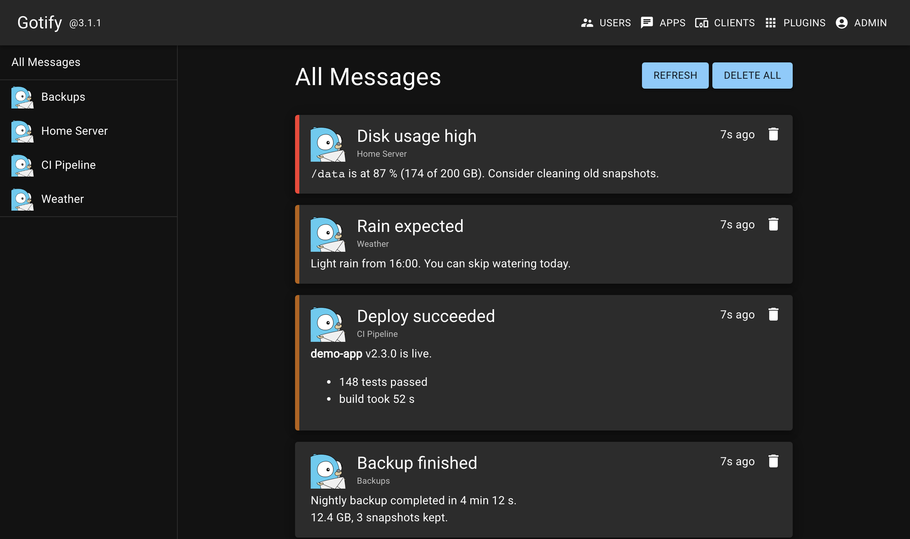

# Gotify on Cloudflare Workers

**Self-hosted [Gotify](https://gotify.net) push notification server on Cloudflare Workers and Durable Objects.** No server to run; works with the official Gotify Android app and web UI.

[](https://deploy.workers.cloudflare.com/?url=https://github.com/Renji61/Gotify-Cloudflare)



> **Unofficial.** This project is not affiliated with or endorsed by the Gotify project.

A Cloudflare Worker serves the official, unmodified Gotify web UI (v3.1.1) and the API. Your data lives in one SQLite-backed Durable Object in your own Cloudflare account. The official Android app works unchanged.

## Features and limits

- Users, applications (with images), clients, messages, the live `/stream` WebSocket, and both legacy and Gotify v3 tokens.
- Same behaviour as Gotify v3.1.1 (paths, status codes, JSON), so the stock web UI and Android app work as they do against the original.
- WebSocket hibernation: connected phones cost almost nothing while idle.
- Import from an existing Gotify database ([below](#migrating-from-a-self-hosted-gotify)).
- **Not included:** plugins (`GET /plugin` returns `[]`), OIDC login, MCP, and the `/swagger` and `/docs` pages.
- Request bodies are limited to 2 MiB (`GOTIFY_SERVER_MAXBODYBYTES`) and application images to 1.5 MiB; upstream has no body limit.
- The `Secure` cookie flag defaults to true (upstream: false).
- No server-side WebSocket pings (they would keep the Durable Object awake), so a browser tab whose connection died silently can look connected until it closes. Upstream's five-minute background job is a Durable Object alarm.
- Everything runs in one Durable Object in one region. That suits one person or a family, not a large installation.

## Deploy

### One click

1. Click the **Deploy to Cloudflare** button above. Cloudflare copies this repo into your GitHub account and builds and deploys the Worker.
2. Enter a long, unique `GOTIFY_DEFAULTUSER_PASS` (at most 72 bytes) when asked. This is the password of the first administrator.
3. Open the `*.workers.dev` URL of the new Worker and log in as `admin`.

This flow depends on Cloudflare's Workers Builds and may change; if it fails, use the manual steps.

### Manual

You need [Node.js](https://nodejs.org) 22.13 or newer, [git](https://git-scm.com) (the UI build clones the Gotify source) and a Cloudflare account.

```sh
git clone https://github.com/Renji61/Gotify-Cloudflare.git
cd Gotify-Cloudflare
npm install
npx wrangler login
npx wrangler secret put GOTIFY_DEFAULTUSER_PASS   # prompts for the password
npm run deploy
```

If wrangler offers to create the Worker `gotify` when you set the secret, answer yes.

`npm run deploy` builds the official web UI from the pinned Gotify tag (the first run takes a few minutes) and uploads everything. Open the `https://gotify.<your-subdomain>.workers.dev` URL it prints and log in as `admin` (the name comes from `GOTIFY_DEFAULTUSER_NAME`). Then create a client or your own user right away.

You can rename the Worker (`gotify`) in `wrangler.jsonc` before the first deploy; it becomes part of the URL.

## Securing it

- **Setup secret.** The first administrator is created from `GOTIFY_DEFAULTUSER_PASS` when the database has no users. Without it no administrator is created and nobody can log in: there is no `admin`/`admin` default. It is ignored once users exist, so change passwords in the UI. Registration is off by default (`GOTIFY_REGISTRATION`).
- **Custom domain** (optional). In `wrangler.jsonc`, uncomment the `routes` example, set `"workers_dev": false` to serve only that hostname, and deploy again.
- **Cloudflare Access.** It adds little here: the API paths (`/message`, `/application`, `/client`, `/stream`, `/image/*`, `/health`, `/version` and others) must stay reachable by the phone app and senders, so Access could only gate `/`, `/index.html`, `/static/*` and `/manifest.json`. Skip it, or add Bypass policies for every other path and test with your phone.
- **Rate limiting.** Each login with a password costs a bcrypt hash and there is no built-in limit. Password logins are bcrypt-checked one at a time in the single Durable Object, so a flood of login attempts can delay message delivery. With a custom domain, a WAF rate limiting rule (**Security → WAF → Rate limiting rules**) reduces this; it isn't available on `workers.dev`.
- **Logs.** Invocation logs are off in `wrangler.jsonc` because `/stream?token=...` carries a client token in the URL. Don't turn them on.

## Phone app

Install the official Gotify Android app, enter your Worker URL in **Gotify URL**, tap **Check URL**, then log in. The app creates its own client and connects to `/stream` for live messages. It needs HTTPS, which `workers.dev` and Cloudflare custom domains provide.

To send a message, create an application in the UI (**Apps**), copy its token and run:

```sh
curl "https://gotify.<your-subdomain>.workers.dev/message" \
  -H "X-Gotify-Key: <application token>" \
  -H "Content-Type: application/json" \
  -d '{"title": "Backup", "message": "Finished without errors", "priority": 5}'
```

## Migrating from a self-hosted Gotify

A one-time import keeps ids, application and client tokens (including old 15-character ones), bcrypt password hashes, timestamps and messages, so senders and the Android app only need the new URL.

Run these from a clone of your copy, after `npm install` and `npx wrangler login`.

1. Stop (or quiet) the old server and copy its `gotify.db`.
2. Set a random token of at least 32 characters (for example `openssl rand -hex 32`) as a secret: `npx wrangler secret put GOTIFY_IMPORT_TOKEN`, then `npm run deploy` so the Durable Object picks it up. Until it is set, `/_import` does not exist.
3. Dry run: `GOTIFY_IMPORT_TOKEN=... node scripts/import-gotify.mjs path/to/gotify.db https://your-worker.example.com` (Node 22.13+). It only prints the target and the counts, then stops. The target must be https (plain http is accepted only for localhost), because the token is sent as a bearer header.
4. The real run: the same command with `--yes` added. It imports and prints the row counts.
5. Disable the route again: `npx wrangler secret delete GOTIFY_IMPORT_TOKEN`, then `npm run deploy`. Deleting the secret alone does not restart the Durable Object, so `POST /_import` keeps answering 401 until you redeploy.

Re-running the import replaces all data. The import is refused unless the data contains at least one admin user. The import body is limited to 16 MiB, so with a very large message history, delete old messages in the old server first. Application images and plugins are not imported: the script refuses a database where an application has an image or a plugin config exists. Remove those in the old server first, or upload the images again afterwards.

## Staying up to date

Nothing updates automatically. If you forked this repo, use GitHub's **Sync fork** and redeploy. A copy made with the Deploy button is a new repository, not a fork: in a clone of it run `git pull https://github.com/Renji61/Gotify-Cloudflare main` (add `--allow-unrelated-histories` the first time if Git refuses), push, and Workers Builds redeploys it (or run `npm run deploy`). For a manual clone of this repo, pull and run `npm install && npm run deploy`.

The Gotify version is pinned in `package.json` (`gotify.tag`); the web UI and server move together.

## Settings

Worker variables in `wrangler.jsonc` under `vars`, named like upstream Gotify's environment variables. Values are quoted strings. Edit them and deploy again.

| Variable | Default | What it does |
| --- | --- | --- |
| `GOTIFY_DEFAULTUSER_NAME` | `"admin"` | Name of the first administrator. |
| `GOTIFY_DEFAULTUSER_PASS` | none | **Secret.** Password of that administrator. |
| `GOTIFY_REGISTRATION` | `"false"` | `"true"` lets anyone create a non-admin user. |
| `GOTIFY_PASSSTRENGTH` | `"10"` | bcrypt cost for new passwords. 4 to 31; below 4 means 10; values above about 12 make logins slow (bcrypt runs in JavaScript). |
| `GOTIFY_SERVER_SECURECOOKIE` | `"true"` | `Secure` flag on the session cookie. Set `"false"` only for local http. |
| `GOTIFY_SERVER_STREAM_ALLOWEDORIGINS` | none | Comma-separated regular expressions for extra `/stream` origins. |
| `GOTIFY_SERVER_CORS_ALLOWORIGINS` | none | Comma-separated regular expressions for CORS origins. Empty refuses other origins, like upstream. |
| `GOTIFY_SERVER_CORS_ALLOWMETHODS` | none | Methods for CORS answers. |
| `GOTIFY_SERVER_CORS_ALLOWHEADERS` | none | Headers for CORS answers. |
| `GOTIFY_SERVER_MAXBODYBYTES` | `"2097152"` | Largest request body in bytes. `"0"` turns the limit off (the 1.5 MiB image limit and a 16 MiB Worker limit still apply). |
| `GOTIFY_SERVER_RESPONSEHEADERS` | none | JSON object of extra response headers. |

The commented examples in `wrangler.jsonc` show the exact format. An invalid value makes the server answer 500 with `invalid configuration: ...` until it is fixed.

## Costs

One personal deployment measured over 24 hours (one user, about 860 requests a day, a phone connected over WebSocket): the Worker used a median of 0.6 ms CPU per request (p99 2.1 ms, max 4.7 ms; the Free plan limit is 10 ms). The Durable Object used about 0.6 s of CPU and 11 s of active time a day (roughly 1.5 GB-s of the Free plan's 13,000 GB-s a day) and handled about 800 requests a day (Free: 100,000). Password checks (bcrypt, about 50-100 ms) run inside the Durable Object, which the Worker's 10 ms limit doesn't cover. No R2 bucket is used.

That fit within the Free plan's limits. Your usage, and Cloudflare's limits and prices, may differ; check the [Workers](https://developers.cloudflare.com/workers/platform/pricing/) and [Durable Objects](https://developers.cloudflare.com/durable-objects/platform/pricing/) pricing pages.

## Troubleshooting

- **Nobody can log in.** The administrator is only created from the `GOTIFY_DEFAULTUSER_PASS` secret. Set it with `npx wrangler secret put GOTIFY_DEFAULTUSER_PASS`, then run `npm run deploy` so the Durable Object restarts. It only works while the database has no users, and the password must be at most 72 bytes: a longer value creates no administrator.
- **Scripts get 403 or Cloudflare error 1010.** Cloudflare's Browser Integrity Check blocks default client user agents such as Python's `Python-urllib`. Set a `User-Agent` header (for example `-H "User-Agent: my-script"` with curl).
- **Login fails in Safari on local `npm run dev`.** Safari refuses `Secure` cookies over plain http. Add `GOTIFY_SERVER_SECURECOOKIE=false` to `.dev.vars` (never in production).
- **A new custom domain doesn't resolve yet.** DNS caches can take a few minutes; try again or flush your resolver cache.

## Local development

```sh
cp .dev.vars.example .dev.vars   # then set GOTIFY_DEFAULTUSER_PASS and add GOTIFY_SERVER_SECURECOOKIE=false
npm run dev                      # http://localhost:8787
npm test                         # Node 22.13+, no Cloudflare account needed
npm run typecheck
```

See [CONTRIBUTING.md](CONTRIBUTING.md) for the project layout and rules.

## Credits

Ported from [Gotify](https://github.com/gotify/server) (MIT, Copyright (c) 2018 jmattheis).

## License

MIT, see [LICENSE](LICENSE).
